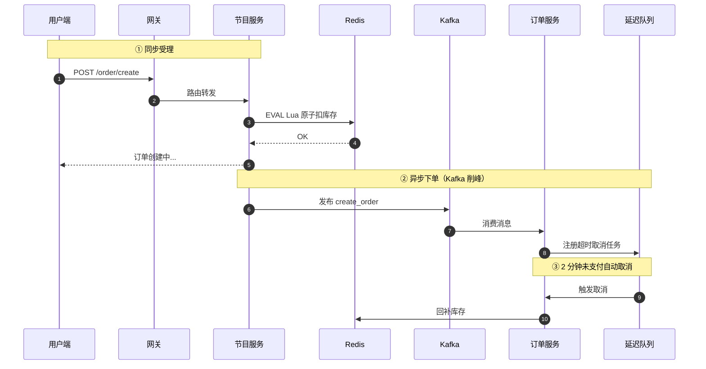
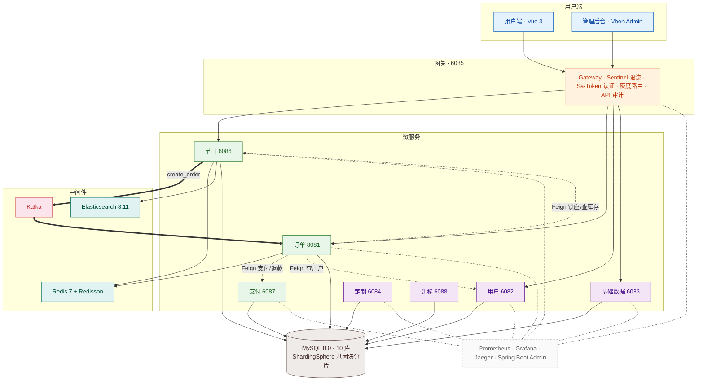

<div align="center">
  
  <h1>TicketFlow</h1>
  <p><b>高并发在线票务交易平台</b></p>

  <p>
    <a href="#核心亮点">核心亮点</a> •
    <a href="#性能基准">性能基准</a> •
    <a href="#系统架构">系统架构</a> •
    <a href="#快速开始">快速开始</a>
  </p>

  <p>
    
    
    
    
    
    
  </p>
</div>

---

## 项目简介

TicketFlow 是一个面向演唱会、体育赛事等场景的在线票务交易平台，采用 Spring Cloud Alibaba 微服务架构。项目围绕高并发抢票的三个核心问题——**库存一致性、流量削峰、系统可用性**——展开，以 Redis、Kafka、ShardingSphere 为主线实现下单链路。

---

## 核心亮点

### 基因法分片路由

订单号预留 6 位基因位嵌入 `userId` 的 Hash 值，基于 ShardingSphere 自定义分片算法，使 `user_id` 与 `order_number` 两个维度都能路由到同一分片，避免跨库查询与读扩散。当前部署为 **2 库 × 8 表（16 张物理表）**，分片数唯一事实来源为 `shardingsphere-order-*.yaml`；扩容需停机迁移。

### 异步下单链路



- Lua 脚本保证库存扣减原子性
- Kafka 削峰，解耦节目服务与订单服务
- 延迟队列实现超时订单自动取消与库存回补

### 多级缓存

`Caffeine → Redis → MySQL` 三级缓存：Redis Stream 广播失效事件驱动集群节点本地缓存同步失效；Caffeine 同 Key 请求合并避免缓存击穿放大数据库压力；布隆过滤器拦截无效节目 ID 查询。

### 分布式锁框架

封装 Redisson 提供**可重入 / 公平 / 读写 / 信号量 / 联锁**五种锁模型，注解声明式使用。通过调整 AOP 与事务拦截器顺序，保证**加锁先于事务开启、释放晚于事务提交**，从框架层规避锁与事务的时序竞态。

---

## 性能基准

下单链路提供 V1 ~ V4 四个演进版本，在本地单机部署下用 **Gatling 开环到达率模型**（恒定 QPS，60s 稳态窗口）压测，各版本成功率对比：

| 版本 | 架构 | 80 QPS | 120 QPS | 160 QPS | 200 QPS |
|------|------|--------|---------|---------|---------|
| **V1** | 方法级粗锁 + 同步 RPC 建单 | 96.7% | 12.1% | 17.7% | 11.9% |
| **V2** | 票档级双锁 + 同步 RPC 建单 | 85.3% | 34.5% | 64.7% | 13.3% |
| **V3** | 本地锁模板 + 同步 RPC 建单 | 98.8% | 36.1% | 37.1% | 38.2% |
| **V4** | 本地锁 + Lua 原子扣减 + Kafka 异步建单 | 100% | 100% | 81.0% | 66.5% |

- V4 单机拐点约 **120–160 QPS**，120 QPS 内成功率接近 100%
- 并发模型演进：整节目串行 → 按票档拆锁 → 锁外异步解耦
- 压测脚本见 `benchmark/`；原始结果不入库（`.gitignore` 忽略 `benchmark/results/`），需本地复跑生成

> 结果随部署环境与硬件变化，仅供参考。

---

## 系统架构



---

## 快速开始

### 环境要求

| 工具 | 版本 |
|------|------|
| Java | 17+ |
| Maven | 3.8+ |
| Node.js / pnpm | 20+ / 9+ |
| Docker & Docker Compose | 最新稳定版 |
| GNU Make（可选） | 用于快捷命令 |

### 一键容器化启动

`make up`（等价 `./docker/build.sh`）一条命令完成：宿主机 Maven 打包 → 暂存 fat-jar → 构建镜像 → compose 启动。

```bash
make up                    # 构建并启动整套系统
make ps                    # 容器状态
make logs SVC=program      # 查看某服务日志
make down                  # 停止（数据卷保留）
```

- 应用镜像由 `docker/app/Dockerfile` 构建，基础镜像 `eclipse-temurin:17-jre-jammy`，非 root 运行
- 支付密钥不入库：首次由 `docker/app/pay.env.example` 生成 `docker/app/pay.env`（已 gitignore）
- Trace 可选：`./docker/otel/download-agent.sh` 下载 agent 后自动挂载
- 仅本机 IDE 跑应用、中间件放容器：`docker compose -f docker/docker-compose.yml up -d mysql redis kafka nacos elasticsearch sentinel`
- 构建后端：`make build`（等价 `mvn -DskipTests -T 4 package`）

### 访问入口

| 入口 | 地址 | 说明 |
|------|------|------|
| 用户端 | `http://localhost:5173` | Vue 3 购票前端 |
| 管理端 | `http://localhost:5555` | Vben Admin 运营后台 |
| API 网关 | `http://localhost:6085` | 所有后端 API 统一入口 |
| Knife4j 文档 | `http://localhost:6085/doc.html` | 在线调试 |
| Nacos | `http://localhost:8848/nacos` | 服务注册与发现 |
| Sentinel | `http://localhost:8082` | 限流熔断（sentinel/sentinel） |
| Grafana | `http://localhost:3000` | 监控看板（admin/admin） |
| Jaeger | `http://localhost:16686` | 链路追踪 |
| Spring Boot Admin | `http://localhost:10082` | 健康监控（admin/admin） |

---

## 技术栈

| 分类 | 技术 |
|------|------|
| 语言 / 主框架 | Java 17 · Spring Boot 3.5 · Spring Cloud 2025 · Spring Cloud Alibaba 2025 |
| 注册/配置/网关 | Nacos 2.4 · Spring Cloud Gateway · Sentinel 1.8 |
| 数据访问 | MyBatis-Plus 3.5 · Apache ShardingSphere JDBC 5.3 |
| 中间件 | Redis 7 + Redisson 3.52 · Kafka 3.6（KRaft）· Elasticsearch 8.11 |
| 认证 / 支付 | Sa-Token + JWT 1.43 · 支付宝 SDK · 微信支付 APIv3 |
| 监控 / 文档 | Prometheus + Grafana · OpenTelemetry + Jaeger · Spring Boot Admin · Knife4j |
| 前端 | Vue 3 + TypeScript + Vite 6 + Element Plus + Pinia（用户端 / Vben Admin 管理端） |

**自研框架**（`ticketflow-*-framework/`）：分布式 ID 生成器（雪花 + 基因法）、验证码、线程池上下文透传、灰度发布、Redis 工具、Redisson 封装、Elasticsearch 集成。

---

## 项目结构

```
ticketflow/
├── ticketflow-common/                    # 共享基础库
├── ticketflow-server/                    # 后端微服务（gateway/user/base-data/program/order/pay/customize/admin/migrate）
├── ticketflow-server-client/             # Feign API 接口
├── ticketflow-*-framework/               # 自研框架（Spring Cloud / Redis / Redisson / ID / ES / 线程池 / 验证码）
├── sql/                                  # 数据库 DDL
├── docker/                               # Compose 编排 + 统一 Dockerfile + OTel 接入
├── k8s/                                  # Kustomize 清单
├── Makefile                              # 常用命令
├── .github/workflows/                    # GitHub Actions CI/CD
├── vue3/                                 # 用户端前端
├── ticketflow-front-manage/              # 管理端前端
└── benchmark/                            # 压测
```
